# Model

The intent-spec model: what a document written in it may contain, what each part means, and the rules a document must meet. The model is the deliverable; how a document is stored is not (INV-11). The Overview is generated; every other section is the source.

## Overview

Every element and link, generated from the Links tables below by `harness.py render`.

```mermaid
erDiagram
  DOCUMENT ||--o{ IMPORT: has
  PRODUCT }o--o{ JOB: targets
  PRODUCT }o--o{ INFLUENCER: answers
  PRODUCT }o--o{ PROFILE: selects
  JOB }o--|| JOB_EXECUTOR: motivates
  JOB }o--o{ EXTERNAL_REFERENCE: cites
  OUTCOME }o--|| JOB: in
  OUTCOME }o--o{ PRODUCT: scopes
  OUTCOME }o--o{ EXTERNAL_REFERENCE: cites
  REQUIREMENT }o--o{ OUTCOME: serves
  REQUIREMENT }o--o{ TREATMENT: executes
  REQUIREMENT }o--o{ ADOPTION: implements
  REQUIREMENT }o--o{ PRODUCT: scopes
  METRIC }o--o{ CONTROL: measures
  METRIC }o--o{ OUTCOME: measures
  THREAT }o--o{ CONTROL: threatens
  THREAT_REVIEW }o--|| THREAT: reviews
  THREAT_REVIEW }o--o{ EXTERNAL_ENTITY: inspects
  THREAT_REVIEW }o--o{ PROCESS: inspects
  THREAT_REVIEW }o--o{ DATA_STORE: inspects
  THREAT_REVIEW }o--o{ DATA_FLOW: inspects
  THREAT_REVIEW }o--o| RISK: raises
  THREAT_REVIEW }o--o{ CONTROL: cites
  THREAT_REVIEW }o--o{ REQUIREMENT: cites
  RISK }o--o{ OUTCOME: endangers
  TREATMENT }o--|{ RISK: treats
  TREATMENT }o--o{ PRODUCT: scopes
  TREATMENT }o--o{ STANDARD: waives
  TREATMENT }o--o{ PROCEDURE: waives
  INFLUENCER }o--o| EXTERNAL_REFERENCE: cites
  INFLUENCER }o--o{ SYSTEM: binds
  INFLUENCER }o--o{ EXTERNAL_REFERENCE: binds
  POLICY }o--o{ INFLUENCER: satisfies
  CONTROL_OBJECTIVE }o--|{ POLICY: supports
  CONTROL_OBJECTIVE }o--o{ INFLUENCER: cites
  STANDARD }o--|{ CONTROL_OBJECTIVE: addresses
  GUIDELINE }o--|{ STANDARD: augments
  ASSESSMENT_OBJECTIVE }o--o{ STANDARD: verifies
  ASSESSMENT_OBJECTIVE }o--|| CONTROL: assesses
  ASSESSMENT_OBJECTIVE }o--o{ PROCEDURE: examines
  CONTROL }o--|{ STANDARD: enforces
  CONTROL }o--|{ CONTROL_OBJECTIVE: achieves
  CONTROL }o--o{ TREATMENT: executes
  PROCEDURE }o--|| CONTROL: operationalizes
  PROFILE }o--o{ PROFILE: imports
  SELECTION }|--|| PROFILE: in
  SELECTION }o--|| CONTROL: names
  ADOPTION }o--|| CONTROL: adopts
  ADOPTION }o--|| PRODUCT: governs
  ADOPTION }o--o| ADOPTION: inherits
  ADOPTION }o--o| EXTERNAL_REFERENCE: inherits
  ADOPTION }o--o| TREATMENT: invokes
  ADOPTION }o--o{ PROCEDURE: follows
  SECURE_BASELINE }o--|{ STANDARD: encodes
  SECURE_BASELINE }o--o| EXTERNAL_REFERENCE: derives
  SECURE_BASELINE }o--o{ DEPLOYMENT_NODE: hardens
  SECURE_BASELINE }o--o{ INFRASTRUCTURE_NODE: hardens
  PERSON }o--o{ JOB_EXECUTOR: plays
  SYSTEM }o--o{ PRODUCT: realizes
  SYSTEM }o--o{ REQUIREMENT: satisfies
  CONTAINER }o--|| SYSTEM: in
  CONTAINER }o--o{ REQUIREMENT: satisfies
  COMPONENT }o--|| CONTAINER: in
  COMPONENT }o--o{ REQUIREMENT: satisfies
  RELATIONSHIP }o--|| PERSON: leaves
  RELATIONSHIP }o--|| SYSTEM: leaves
  RELATIONSHIP }o--|| CONTAINER: leaves
  RELATIONSHIP }o--|| COMPONENT: leaves
  RELATIONSHIP }o--|| INFRASTRUCTURE_NODE: leaves
  RELATIONSHIP }o--|| PERSON: enters
  RELATIONSHIP }o--|| SYSTEM: enters
  RELATIONSHIP }o--|| CONTAINER: enters
  RELATIONSHIP }o--|| COMPONENT: enters
  RELATIONSHIP }o--|| INFRASTRUCTURE_NODE: enters
  DYNAMIC_DIAGRAM }o--|| REQUIREMENT: illustrates
  DYNAMIC_DIAGRAM }o--o| SYSTEM: depicts
  DYNAMIC_DIAGRAM }o--o| CONTAINER: depicts
  DYNAMIC_STEP }|--|| DYNAMIC_DIAGRAM: in
  DYNAMIC_STEP }o--|| RELATIONSHIP: follows
  DEPLOYMENT_DIAGRAM }o--|{ SYSTEM: depicts
  DEPLOYMENT_DIAGRAM }o--|| ENVIRONMENT: covers
  ENVIRONMENT }o--|{ PRODUCT: serves
  DEPLOYMENT_NODE }o--o{ REQUIREMENT: satisfies
  DEPLOYMENT_NODE }o--o| ENVIRONMENT: belongs
  DEPLOYMENT_NODE }o--o| DEPLOYMENT_NODE: in
  SYSTEM_INSTANCE }o--|| DEPLOYMENT_NODE: in
  SYSTEM_INSTANCE }o--|| SYSTEM: instantiates
  CONTAINER_INSTANCE }o--|| DEPLOYMENT_NODE: in
  CONTAINER_INSTANCE }o--|| CONTAINER: instantiates
  INFRASTRUCTURE_NODE }o--|| DEPLOYMENT_NODE: in
  EXTERNAL_ENTITY }o--o| PERSON: represents
  EXTERNAL_ENTITY }o--o| SYSTEM: represents
  PROCESS }o--o| SYSTEM: represents
  PROCESS }o--o| CONTAINER: represents
  PROCESS }o--o| COMPONENT: represents
  PROCESS }o--o| INFRASTRUCTURE_NODE: represents
  DATA_STORE }o--o| CONTAINER: represents
  DATA_STORE }o--|{ DATA_ELEMENT: stores
  DATA_ELEMENT }o--o{ INFLUENCER: triggers
  DATA_FLOW }o--o{ EXTERNAL_ENTITY: connects
  DATA_FLOW }o--o{ PROCESS: connects
  DATA_FLOW }o--o{ DATA_STORE: connects
  DATA_FLOW }o--o| EXTERNAL_ENTITY: leaves
  DATA_FLOW }o--o| PROCESS: leaves
  DATA_FLOW }o--o| DATA_STORE: leaves
  DATA_FLOW }o--|{ DATA_ELEMENT: carries
  DATA_FLOW }o--o{ RELATIONSHIP: represents
  TRUST_BOUNDARY }o--o{ EXTERNAL_ENTITY: encloses
  TRUST_BOUNDARY }o--o{ PROCESS: encloses
  TRUST_BOUNDARY }o--o{ DATA_STORE: encloses
  TRUST_BOUNDARY }o--o| TRUST_BOUNDARY: in
  TRUST_BOUNDARY }o--o{ CONTAINER: relies
  TRUST_BOUNDARY }o--o{ INFRASTRUCTURE_NODE: relies
  TRUST_BOUNDARY }o--o{ DEPLOYMENT_NODE: relies
  TRUST_BOUNDARY }o--o{ CONTROL: relies
  TRUST_BOUNDARY }o--o{ SYSTEM: relies
  DATA_FLOW_DIAGRAM }o--|| SYSTEM: depicts
  DATA_FLOW_DIAGRAM }o--|| CONTAINER: depicts
  DATA_FLOW_DIAGRAM }o--o{ EXTERNAL_ENTITY: includes
  DATA_FLOW_DIAGRAM }o--o{ PROCESS: includes
  DATA_FLOW_DIAGRAM }o--o{ DATA_STORE: includes
```

<!-- overview: generated by `harness.py render`; do not edit -->

<!-- /overview -->

## Conventions

How to read this file, and the meaning and rules that apply to every element.

**Elements.** Each `###` section is one element (an entity type). It gives a definition, an `Anchor:` line, an Attributes table and a Links table, then any rules, derivations and guidance checked from it. Rules, derivations and guidance that span an area sit at the top of the area's `##` section.

**Anchors.** An `Anchor:` line says how the element relates to the established model it comes from (INV-9): `exact`, `close`, `broad`, `narrow` or `related` to a source term, `added` when no source model has it, or `departure` when it changes a source model's own element or relationship, which needs a decision (INV-10) named as `(decision: <bead id>)`.

**Attributes.** An attribute is optional unless its Required cell says otherwise: `yes`, `one or more` (a list that must be non-empty), or a condition starting `when` or `unless`. An optional attribute without a stated default is absent when omitted. A type ending in `[]` is a list; `enum (a, b)` lists the allowed values. A date is an ISO 8601 calendar date (YYYY-MM-DD).

**Links.** Every link is a reference, labelled with a single action verb, and points from the dependent item to its anchor. Rows with the same verb are one link, stored as one field on the source item; its target may be any element named in those rows. The Cardinality cell counts the targets of one source item, over all its target types together: for example, a relationship leaves exactly one person or system. Where cardinality would differ per target type, the link uses a different verb per type. "Each target has" counts the source items per target when that is not zero or more. Containment is the link `in`, drawn from the contained item to its container like any other link; rule prose says X contains Y (or hosts Y) to mean Y in X. There are no abstract placeholder elements: links go to concrete elements.

**References.** A link's target is a local item id or an imported `alias:id`. Only a link to EXTERNAL_REFERENCE may instead target the id of an external reference, for things outside intent-spec: job cites, outcome cites, adoption inherits, influencer cites, influencer binds, secure baseline derives.

**Items.** Every item has a document-unique id. Items never nest. Every item except an external reference, which is not intent, has a stage: proposed, ratified or deprecated; stages are intent, not observed state, and an item states its stage only where it differs from the document's stage. A deprecated item names its replacement (replacedBy) or, when nothing replaces it, gives a deprecationRationale. Every item may also have a name and a description (free text, optional); they are not repeated in each element, and rule C4-1 asks for both on C4 elements. Every item may also have ruleWaivers (optional): a map from the ID of a warning rule to a rationale for why that warning does not apply to the item. A checker reports a waived warning as waived, with its rationale, instead of dropping it. (A treatment's waives link is unrelated: it waives standards and procedures.)

**Coverage.** Coverage applies to what a scope selects: every selected item has exactly one disposition. DFD elements stay separate from C4 elements and may optionally represent them; they model different things (INV-12).

**Rule IDs.** Each rule and derivation has an ID (AREA-n). An ID is never renumbered or reused; a removed rule retires its ID. A rule is an error unless marked warning. A rule or derivation that uses a derivation cites its ID in brackets. A guidance line is review advice that cannot be checked mechanically; it is not a rule and has no ID.

Retired: RISK-3, C4-9, C4-18, DFD-2, DFD-16.

The retired IDs became link cardinality.

Not checked by a query: DOC-1, RISK-5, REF-2, REF-5.

DOC-1 and RISK-5 compare two versions of a document; REF-2 and REF-5 are behaviours every rule applies.

Generated checks: SCHEMA-ATTR, SCHEMA-ENUM, SCHEMA-LINK.

The generated checks come from the Attributes and Links tables: required attributes, enum values and link cardinality.

**Rules**

- **DOC-1** (error): removing or renaming an item id is a breaking change (major version)
- **DOC-3** (error): every key of an item's ruleWaivers is the ID of a (should) rule; waiving an error-severity rule or an unknown ID is itself an error
- **REF-1** (error): a link not drawn to EXTERNAL_REFERENCE resolves to a local or imported item; an external reference there is a type error
- **REF-2** (error): where allowed, an external reference satisfies a link's cardinality; rules that inspect the target skip it
- **REF-3** (error): a ratified item does not link to a proposed item [DOC-2]
- **REF-4** (warning): a ratified item does not link to a deprecated item, except a review of a deprecated target [DOC-2]
- **REF-5** (error): coverage rules apply only to items declared in this document; an imported or external system is treated as external
- **REF-6** (error): a link's target is an item of an entity type drawn for that link; generated from the ERD for every link, so other rules do not repeat it

**Derived**

- **DOC-2**: an item's stage is its own stage, or else the document's stage; every rule that names a stage means this one

## Documents

### DOCUMENT

The document is the unit of distribution; its fields are the header, not an item.

Anchor: added — the unit of distribution; no source model has it.

| Attribute | Type | Required | Meaning |
|---|---|---|---|
| id | string | yes | package name, e.g. openemr |
| version | string | yes | semver |
| intentSpec | string | yes | contract version |
| stage | string | yes | proposed \| ratified \| deprecated; the stage of every item that states none |

| Link | Target | Cardinality | Meaning |
|---|---|---|---|
| has | IMPORT | zero or more; each target has exactly one | |

### IMPORT

A dependency on another intent-spec document, named by a local alias.

Anchor: added — part of the reference mechanism (INV-7).

| Attribute | Type | Required | Meaning |
|---|---|---|---|
| alias | string | yes | local prefix in alias:id; unique in the document |
| source | string | yes | where the imported document is fetched from |
| version | string | yes | semver range |

Links: none.

### EXTERNAL_REFERENCE

Something outside intent-spec that a link may point to, such as a law, a standard or a provider's SOC 2 report. It is not intent, so it has no stage.

Anchor: added — part of the reference mechanism (INV-7).

| Attribute | Type | Required | Meaning |
|---|---|---|---|
| title | string | yes | free text |
| url | string | no |  |
| party | string | no | who it comes from, e.g. AWS |
| version | string | no | edition or date |

Links: none.

## Product

Constraints and forces of progress are deliberately out of scope.

### PRODUCT

What a team builds and offers, hired by job executors to get jobs done.

Anchor: added — joins JTBD jobs to C4 systems (INV-12).

Attributes: none.

| Link | Target | Cardinality | Meaning |
|---|---|---|---|
| targets | JOB | zero or more | |
| answers | INFLUENCER | zero or more | |
| selects | PROFILE | zero or more | |

**Rules**

- **PRODUCT-1** (error): every ratified product targets at least one job
- **PRODUCT-2** (error): a job targeted by a ratified product has at least one ratified outcome

### JOB_EXECUTOR

The person or group who does the job (the JTBD job executor).

Anchor: exact — JTBD job executor.

| Attribute | Type | Required | Meaning |
|---|---|---|---|
| description | string | yes | the person or group who does the job, described by role (the JTBD job executor) |

Links: none.

**Rules**

- **PRODUCT-3** (warning): every job executor is motivated by at least one job

### JOB

The progress a job executor is trying to make in a given circumstance. A core job is what the product is hired for; a related job is done alongside it; a consumption job is about living with the product (setting up, upgrading, running it); a purchase job is choosing and paying for it, and its executor is the buyer. A purchase job's outcomes are usually served by commercial commitments (pricing, terms, procurement paperwork): requirements with a verification that no system, container, component or deployment node satisfies [C4-8].

Anchor: exact — JTBD job, with core, related, consumption and purchase job types.

| Attribute | Type | Required | Meaning |
|---|---|---|---|
| statement | string | yes | from the executor's perspective; may include the circumstance, e.g. when planning next week's shifts |
| kind | enum (core, related, consumption, purchase) | no | default core |

| Link | Target | Cardinality | Meaning |
|---|---|---|---|
| motivates | JOB_EXECUTOR | exactly one | |
| cites | EXTERNAL_REFERENCE | zero or more | |

**Guidance**

- the statement of a core or related job, and of its outcomes, is solution-free; a consumption or purchase job and its outcomes may name the product

### OUTCOME

A measurable result a job executor wants from getting a job done (a JTBD desired outcome). Disposition: out-of-scope means the products it applies to will not serve the outcome; deferred means they will, but not yet; overserved means they already satisfy it beyond what executors value, so no further requirements will be added for it.

Anchor: close — JTBD desired outcome; disposition and scoping are added.

| Attribute | Type | Required | Meaning |
|---|---|---|---|
| statement | string | yes | measurable |
| disposition | enum (out-of-scope, overserved, deferred) | no |  |
| rationale | string | when it has a disposition |  |

| Link | Target | Cardinality | Meaning |
|---|---|---|---|
| in | JOB | exactly one | |
| scopes | PRODUCT | zero or more | |
| cites | EXTERNAL_REFERENCE | zero or more | |

**Rules**

- **PRODUCT-4** (error): an outcome scopes products only when it has a disposition, and only products that target its job
- **PRODUCT-5** (error): for every ratified product that targets its job, every ratified outcome is served by at least one ratified requirement that applies to that product [PRODUCT-8] or has a disposition that applies to it [PRODUCT-7], never both unless that disposition is overserved

**Derived**

- **PRODUCT-7**: a disposition applies to the products the outcome scopes, or to every product that targets its job when it scopes none

### REQUIREMENT

A requirement is a solution-side commitment the team builds; mandatory organisational requirements are STANDARDs.

Anchor: added — the solution-side commitment that joins outcomes, treatments and adoptions to C4 elements.

| Attribute | Type | Required | Meaning |
|---|---|---|---|
| statement | string | yes |  |
| verification | string | yes | how satisfaction is checked |

| Link | Target | Cardinality | Meaning |
|---|---|---|---|
| serves | OUTCOME | zero or more | |
| executes | TREATMENT | zero or more | |
| implements | ADOPTION | zero or more | |
| scopes | PRODUCT | zero or more | |

**Rules**

- **PRODUCT-6** (error): every requirement serves an outcome, executes a treatment, implements an adoption or is cited by a threat review
- **C4-8** (error): every ratified requirement is satisfied by at least one system, container, component or deployment node, unless it serves only outcomes of purchase jobs and executes no treatment and implements no adoption

**Derived**

- **PRODUCT-8**: a requirement applies to the products it scopes; when it scopes none, it applies to every product that targets the job of an outcome it serves, every product governed by an adoption it implements, and every product a treatment it executes applies to [RISK-17]

## Measurement

Shared by product and governance.

### METRIC

A measure tracked against a target at a set frequency, for a control or an outcome.

Anchor: exact — HCGF metric.

| Attribute | Type | Required | Meaning |
|---|---|---|---|
| target | string | yes | threshold |
| frequency | string | yes |  |

| Link | Target | Cardinality | Meaning |
|---|---|---|---|
| measures | CONTROL or OUTCOME | zero or more | |

**Rules**

- **METRIC-1** (error): every metric measures at least one control or outcome

**Guidance**

- a metric that measures an outcome tracks that outcome's own measure from the executor's side (time to see a trend, automations lost offline); a product-side threshold such as script size or load time belongs in a requirement's statement or verification

## Risk

### THREAT

Something that can go wrong, classified by STRIDE category. Threatens is HCGF's sense: the threat can stop the control working as expected (not "the control mitigates the threat"). STRIDE-per-element set: external-entity S,R; process S,T,R,I,D,E; data-store T,R,I,D; data-flow T,I,D. Category other allows any appliesTo.

Anchor: close — HCGF threat, classified by STRIDE.

| Attribute | Type | Required | Meaning |
|---|---|---|---|
| category | enum (spoofing, tampering, repudiation, information-disclosure, denial-of-service, elevation-of-privilege, other) | yes |  |
| appliesTo | enum[] (external-entity, process, data-store, data-flow) | no | empty means not reviewed per DFD element |
| rationale | string | when appliesTo is outside the STRIDE-per-element set |  |

| Link | Target | Cardinality | Meaning |
|---|---|---|---|
| threatens | CONTROL | zero or more | |

**Rules**

- **RISK-1** (warning): appliesTo is within the STRIDE-per-element set for the category, or the threat gives a rationale
- **RISK-2** (warning): every threat threatens at least one control, or some review of it cites a control or requirement

### THREAT_REVIEW

A recorded judgment of one threat against the DFD elements it inspects, with one disposition. Disposition: covered means the cited safeguards leave no exposure at the targets that needs an owner or a review date; risk means some exposure remains to own, even when a reduce treatment addresses it; not-applicable means the threat leaves no such exposure there even without safeguards, and the rationale says why.

Anchor: added — joins threats to DFD elements and risks; no source model stores the review.

| Attribute | Type | Required | Meaning |
|---|---|---|---|
| disposition | enum (risk, covered, not-applicable) | yes |  |
| rationale | string | when not-applicable |  |

| Link | Target | Cardinality | Meaning |
|---|---|---|---|
| reviews | THREAT | exactly one | |
| inspects | EXTERNAL_ENTITY or PROCESS or DATA_STORE or DATA_FLOW | zero or more | |
| raises | RISK | zero or one | |
| cites | CONTROL or REQUIREMENT | zero or more | |

**Rules**

- **RISK-16** (error): a review inspects at least one target, and all its targets are of one kind
- **RISK-4** (error): every (threat, target) pair where the threat applies to the target's kind is inspected by exactly one review; one review records one disposition for every target it inspects
- **RISK-5** (error): a deprecated target keeps its reviews
- **RISK-6** (error): raises exactly one risk when disposition is risk; otherwise none
- **RISK-7** (error): cites at least one control or requirement when disposition is covered; otherwise none
- **RISK-18** (warning): a review whose disposition is not-applicable inspects no data flow that crosses a trust boundary [DFD-11]
- **RISK-10** (error): when disposition is covered, for every product of the review [RISK-9], at least one cited control is adopted in mode system, procedure or inherited by that product, or at least one cited requirement applies to that product [PRODUCT-8] and is satisfied by a system that realizes that product, or by a container or component in one

**Derived**

- **RISK-8**: a DFD's products are those realized by the system it depicts, or by the system containing the container it depicts
- **RISK-9**: a review's products are the products [RISK-8] of every DFD that includes, or shows [DFD-20], an element it inspects
- **RISK-11**: a threat poses every risk raised by a review of it

### RISK

Exposure that remains after a threat review and needs an owner; it endangers outcomes.

Anchor: close — HCGF risk.

Attributes: none.

| Link | Target | Cardinality | Meaning |
|---|---|---|---|
| endangers | OUTCOME | zero or more | |

**Rules**

- **RISK-12** (error): every risk has at least one treatment

### TREATMENT

How a risk is handled: avoided, reduced, transferred or accepted.

Anchor: added — risk treatment (avoid, reduce, transfer, accept).

| Attribute | Type | Required | Meaning |
|---|---|---|---|
| strategy | enum (avoid, reduce, transfer, accept) | yes |  |
| owner | string | yes | accountable person; for accept, who accepted |
| reviewBy | date | when reduce or accept |  |
| rationale | string | unless reduce | names the removed feature, the receiving party, or why the risk is accepted |

| Link | Target | Cardinality | Meaning |
|---|---|---|---|
| treats | RISK | one or more | |
| scopes | PRODUCT | zero or more | |
| waives | STANDARD or PROCEDURE | zero or more | |

**Rules**

- **RISK-13** (error): a reduce treatment is executed by at least one control or requirement
- **RISK-14** (error): a control executing a treatment is adopted in mode system, procedure or inherited by every product the treatment applies to [RISK-17]
- **RISK-15** (error): waives only when strategy is accept; a waiver applies only within the products the treatment applies to [RISK-17]

**Derived**

- **RISK-17**: a treatment applies to the products it scopes, or to every product in the document when it scopes none

## GRC

Follows ComplianceForge's Hierarchical Cybersecurity Governance Framework (HCGF).

**Derived**

- **GRC-19**: a product's system security plan (SSP) is its adoptions with their controls, standards, procedures, requirements and inheritance
- **GRC-20**: a product's customer responsibility matrix is its delegated adoptions
- **GRC-21**: a product's plan of action and milestones (POA&M) is the reduce treatments and accept waivers that apply to it [RISK-17]

### INFLUENCER

A source of obligations that governance answers: a statute, regulation, contract or internal requirement.

Anchor: close — HCGF statutory, regulatory and contractual influencers.

| Attribute | Type | Required | Meaning |
|---|---|---|---|
| kinds | enum[] (statutory, regulatory, contractual, internal) | one or more |  |
| scopeRationale | string | yes | why it applies |

| Link | Target | Cardinality | Meaning |
|---|---|---|---|
| cites | EXTERNAL_REFERENCE | zero or one | |
| binds | SYSTEM or EXTERNAL_REFERENCE | zero or more | |

**Rules**

- **GRC-1** (error): a statutory, regulatory or contractual influencer cites exactly one source
- **GRC-24** (error): only a contractual influencer binds, and only external systems or external references that have a party; binds names the counterparty (an external reference's party), e.g. a BAA or DPA sub-processor or a hosting provider
- **GRC-25** (warning): an external system is bound by at least one contractual influencer when an external entity representing it connects a data flow carrying a data element that triggers a statutory or regulatory influencer
- **GRC-33** (warning): every influencer that applies to at least one product [GRC-27] is satisfied by at least one policy or cited by at least one control objective

**Derived**

- **GRC-27**: an influencer applies to the products that answer it; a local influencer that no product answers applies to every product in the document, and an imported one to none

### POLICY

A statement of management intent, approved by an accountable authority (HCGF policy).

Anchor: exact — HCGF policy.

| Attribute | Type | Required | Meaning |
|---|---|---|---|
| statement | string | yes | management intent |
| approver | string | yes | the accountable authority that approves the policy, e.g. executive leadership, a board or maintainers |

| Link | Target | Cardinality | Meaning |
|---|---|---|---|
| satisfies | INFLUENCER | zero or more | |

**Rules**

- **GRC-2** (warning): every policy satisfies at least one influencer

### CONTROL_OBJECTIVE

The result a policy needs and controls achieve (HCGF control objective).

Anchor: exact — HCGF control objective.

| Attribute | Type | Required | Meaning |
|---|---|---|---|
| statement | string | yes | the desired result |
| clauses | string[] | no | sections or clauses of the cited influencers' sources it answers, e.g. 45 CFR 164.312(b) |

| Link | Target | Cardinality | Meaning |
|---|---|---|---|
| supports | POLICY | one or more | |
| cites | INFLUENCER | zero or more | |

**Rules**

- **GRC-29** (error): a control objective has clauses only when it cites at least one influencer
- **GRC-34** (warning): every influencer a control objective cites is satisfied by at least one policy it supports
- **GRC-22** (warning): every control objective is achieved by at least one control

### STANDARD

A mandatory, measurable requirement that addresses control objectives (HCGF standard).

Anchor: exact — HCGF standard.

| Attribute | Type | Required | Meaning |
|---|---|---|---|
| statement | string | yes | the mandatory, measurable requirement |

| Link | Target | Cardinality | Meaning |
|---|---|---|---|
| addresses | CONTROL_OBJECTIVE | one or more | |

**Rules**

- **GRC-23** (warning): every standard is enforced by at least one control

### GUIDELINE

Recommended, non-mandatory practice that augments standards (HCGF guideline).

Anchor: exact — HCGF guideline.

Attributes: none.

| Link | Target | Cardinality | Meaning |
|---|---|---|---|
| augments | STANDARD | one or more | |

### ASSESSMENT_OBJECTIVE

What an assessor checks to confirm a control works, and how.

Anchor: close — HCGF assessment objective, with NIST SP 800-53A methods.

| Attribute | Type | Required | Meaning |
|---|---|---|---|
| methods | enum[] (examine, interview, test) | one or more |  |
| evidence | string | yes | what an assessor should look for |

| Link | Target | Cardinality | Meaning |
|---|---|---|---|
| verifies | STANDARD | zero or more | |
| assesses | CONTROL | exactly one | |
| examines | PROCEDURE | zero or more | |

**Rules**

- **GRC-3** (error): an assessment objective verifies only standards its control enforces
- **GRC-4** (error): an assessment objective examines only procedures that operationalize its control
- **GRC-5** (warning): every control is assessed by at least one assessment objective

### CONTROL

A safeguard that enforces standards and achieves control objectives (HCGF control).

Anchor: exact — HCGF control.

| Attribute | Type | Required | Meaning |
|---|---|---|---|
| statement | string | yes | the safeguard |
| owner | string | yes | stakeholder |
| safeguard | enum (technical, administrative, physical) | yes |  |

| Link | Target | Cardinality | Meaning |
|---|---|---|---|
| enforces | STANDARD | one or more | |
| achieves | CONTROL_OBJECTIVE | one or more | |
| executes | TREATMENT | zero or more | |

**Derived**

- **GRC-6**: a control's influencers are those its control objectives cite; a control objective that cites none contributes the influencers its policies satisfy

### PROCEDURE

The steps that put a control into practice (HCGF procedure).

Anchor: exact — HCGF procedure.

| Attribute | Type | Required | Meaning |
|---|---|---|---|
| steps | string | yes | what is done, in order |
| owner | string | yes | process owner / asset custodian |
| overseer | string | yes | stakeholder oversight |

| Link | Target | Cardinality | Meaning |
|---|---|---|---|
| operationalizes | CONTROL | exactly one | |

### PROFILE

A profile is a company-level selection of controls (OSCAL profile); a product selects the profiles that apply to it. A profile may import other profiles and narrow them with exclude selections, e.g. a product line's baseline minus one control.

Anchor: added — OSCAL-style profile; OSCAL is not one of the anchored models (INV-9).

| Attribute | Type | Required | Meaning |
|---|---|---|---|
| owner | string | yes | accountable authority for the profile's selections, who decides changes to the baseline |

| Link | Target | Cardinality | Meaning |
|---|---|---|---|
| imports | PROFILE | zero or more | |

**Rules**

- **GRC-32** (error): profile imports have no cycles

**Derived**

- **GRC-31**: a profile includes a control when it, or a profile it imports, includes it, and it does not exclude it

### SELECTION

One profile's decision to include or exclude one control.

Anchor: added — OSCAL-style profile selection.

| Attribute | Type | Required | Meaning |
|---|---|---|---|
| choice | enum (include, exclude) | yes |  |
| rationale | string | when exclude |  |

| Link | Target | Cardinality | Meaning |
|---|---|---|---|
| in | PROFILE | exactly one; each target has one or more | |
| names | CONTROL | exactly one | |

**Rules**

- **GRC-8** (error): at most one selection per (profile, control) pair

### ADOPTION

A product's decision about how it meets one control. Inherited means the control is provided upstream, by a party the product relies on, e.g. a cloud provider; it is coverage. Delegated means the control applies but whoever runs or deploys the product must implement it; it is not coverage.

Anchor: added — joins HCGF controls to products (INV-12).

| Attribute | Type | Required | Meaning |
|---|---|---|---|
| mode | enum (system, procedure, inherited, delegated, excepted, not-applicable) | yes |  |
| rationale | string | when delegated or not-applicable |  |
| decidedBy | string | when inherited, delegated, excepted or not-applicable | who made the governance decision |
| delegatedTo | string | when delegated, otherwise none | the downstream party that must implement the control, e.g. the deploying customer |
| owner | string | no | who is accountable for the control in this product; the control's owner defines it |

| Link | Target | Cardinality | Meaning |
|---|---|---|---|
| adopts | CONTROL | exactly one | |
| governs | PRODUCT | exactly one | |
| inherits | ADOPTION or EXTERNAL_REFERENCE | zero or one | |
| invokes | TREATMENT | zero or one | |
| follows | PROCEDURE | zero or more | |

**Rules**

- **GRC-7** (error): an adoption follows only procedures that operationalize the adopted control
- **GRC-9** (error): at most one adoption per (product, control) pair
- **GRC-10** (error): a product has an adoption for every control that a profile it selects includes [GRC-31] (coverage)
- **GRC-11** (error): a system adoption is implemented by at least one requirement, every requirement implementing an adoption applies to the adoption's product [PRODUCT-8], a procedure adoption follows at least one procedure, and other modes do neither
- **GRC-12** (error): when mode is inherited, inherits exactly one target; otherwise none
- **GRC-13** (error): an external reference that an adoption inherits has a party
- **GRC-30** (warning): an adoption does not inherit an external reference whose party is the operator of an environment that serves the adoption's product; that operator is downstream, so the adoption is delegated
- **GRC-14** (error): an inherited adoption adopts the same control as the adoption it inherits
- **GRC-15** (error): an inheritance chain ends at a system or procedure adoption or an external reference (no cycles)
- **GRC-28** (error): when mode is not-applicable, none of the adopted control's influencers [GRC-6] applies [GRC-27] to the adoption's product
- **GRC-26** (warning): a system or procedure adoption has an owner
- **GRC-16** (error): when mode is excepted, invokes exactly one treatment, which is an accept treatment that applies to [RISK-17] the adoption's product and waives every standard the adopted control enforces; otherwise none

### SECURE_BASELINE

A hardening configuration that encodes standards for deployment and infrastructure nodes, e.g. a CIS benchmark.

Anchor: related — HCGF secure baseline configuration.

Attributes: none.

| Link | Target | Cardinality | Meaning |
|---|---|---|---|
| encodes | STANDARD | one or more | |
| derives | EXTERNAL_REFERENCE | zero or one | |
| hardens | DEPLOYMENT_NODE or INFRASTRUCTURE_NODE | zero or more | |

**Rules**

- **GRC-18** (warning): a secure baseline derives from a CIS benchmark, DISA STIG or vendor guide

**Derived**

- **GRC-17**: a secure baseline hardens every node contained in, or hosted by, a deployment node it hardens

## C4

Follows the C4 model's [abstractions](https://c4model.com/abstractions) and [diagrams](https://c4model.com/diagrams).

The landscape, context, container and component diagrams are fully derived. Dynamic and deployment diagrams store a scope; DFDs list their elements.

The C4 code level is omitted: it is derived from source, not declared intent.

**Rules**

- **C4-1** (warning): every person, system, container and component has a name and a short description
- **C4-2** (warning): every container and component, and every stored relationship whose ends lie in different containers or systems, has a technology

**Derived**

- **C4-14**: the document has one system landscape: every system and person, and the relationships between them
- **C4-15**: each internal system has a system context diagram: the system plus every person and system joined to it
- **C4-16**: each internal system with containers has a container diagram: its containers plus the people and systems joined to them
- **C4-17**: each application container with components has a component diagram: its components plus the containers, people and systems joined to them

### PERSON

A human user of a software system (C4 person).

Anchor: exact — C4 person.

Attributes: none.

| Link | Target | Cardinality | Meaning |
|---|---|---|---|
| plays | JOB_EXECUTOR | zero or more | |

### SYSTEM

A software system that delivers value to its users (C4 software system).

Anchor: exact — C4 software system.

| Attribute | Type | Required | Meaning |
|---|---|---|---|
| owner | string | when internal | team that builds and runs it |
| external | boolean | no | not built and owned by the team that owns this document; default false |

| Link | Target | Cardinality | Meaning |
|---|---|---|---|
| realizes | PRODUCT | zero or more | |
| satisfies | REQUIREMENT | zero or more | |

**Rules**

- **C4-3** (error): a ratified internal system that realizes a product contains at least one container; a proposed one may stop at its system context [DOC-2]
- **C4-4** (error): an external system contains no containers
- **C4-5** (error): only an internal system realizes a product

### CONTAINER

An application or data store that must run for the system to work (C4 container).

Anchor: exact — C4 container.

| Attribute | Type | Required | Meaning |
|---|---|---|---|
| kind | enum (application, data-store) | yes |  |
| technology | string | no |  |

| Link | Target | Cardinality | Meaning |
|---|---|---|---|
| in | SYSTEM | exactly one | |
| satisfies | REQUIREMENT | zero or more | |

**Rules**

- **C4-6** (warning): only an application container contains components

### COMPONENT

A grouping of related functionality inside an application container (C4 component).

Anchor: exact — C4 component.

| Attribute | Type | Required | Meaning |
|---|---|---|---|
| technology | string | no |  |

| Link | Target | Cardinality | Meaning |
|---|---|---|---|
| in | CONTAINER | exactly one | |
| satisfies | REQUIREMENT | zero or more | |

### RELATIONSHIP

A relationship between two C4 elements. A relationship is unidirectional and points from the requester to the responder.

Anchor: exact — C4 relationship.

| Attribute | Type | Required | Meaning |
|---|---|---|---|
| description | string | no | specific, consistent with direction; avoid bare 'uses' |
| technology | string | no |  |

| Link | Target | Cardinality | Meaning |
|---|---|---|---|
| leaves | PERSON or SYSTEM or CONTAINER or COMPONENT or INFRASTRUCTURE_NODE | exactly one | |
| enters | PERSON or SYSTEM or CONTAINER or COMPONENT or INFRASTRUCTURE_NODE | exactly one | |

**Rules**

- **C4-10** (error): a relationship with an infrastructure-node end appears only in deployment diagrams
- **C4-11** (error): the two ends of a relationship are distinct and neither contains the other
- **C4-25** (warning): every stored relationship with an end at an application container that contains components is implied [C4-12] by a stored relationship with that end at one of its components

**Derived**

- **C4-12**: a relationship implies one between each enclosing container or system of its source and of its destination, where neither contains the other, unless one is stored
- **C4-13**: an implied relationship's description and technology are those of the relationships that imply it; store one at the higher level to give it a curated label

### DYNAMIC_DIAGRAM

A C4 dynamic diagram: an ordered sequence of steps that illustrates one requirement. The system or container a dynamic diagram depicts sets its C4 level; with neither it is a landscape-level diagram.

Anchor: close — C4 dynamic diagram, scoped to a requirement.

Attributes: none.

| Link | Target | Cardinality | Meaning |
|---|---|---|---|
| illustrates | REQUIREMENT | exactly one | |
| depicts | SYSTEM or CONTAINER | zero or one | |

### DYNAMIC_STEP

One numbered interaction in a dynamic diagram, following a stored relationship.

Anchor: close — C4 dynamic diagram's numbered interactions, stored as items.

| Attribute | Type | Required | Meaning |
|---|---|---|---|
| order | int | yes | position of the step in its diagram |
| description | string | no | overrides the relationship's description |
| direction | enum (request, response) | no | default request; a response runs from the relationship's destination back to its source |

| Link | Target | Cardinality | Meaning |
|---|---|---|---|
| in | DYNAMIC_DIAGRAM | exactly one; each target has one or more | |
| follows | RELATIONSHIP | exactly one | |

**Rules**

- **C4-26** (error): step order is unique among the steps in one dynamic diagram
- **C4-19** (error): a step is drawn between its relationship's ends lifted to the diagram's level [C4-12]: a component stays when the diagram depicts its container and otherwise lifts to its container; a container stays when the diagram depicts its system or any container and otherwise lifts to its system; the two drawn ends differ

### DEPLOYMENT_DIAGRAM

A C4 deployment diagram: how the systems it depicts are deployed in one environment. NotDeployed keys are references to CONTAINER, checked by REF-1 and REF-6 like links.

Anchor: close — C4 deployment diagram; notDeployed is added.

| Attribute | Type | Required | Meaning |
|---|---|---|---|
| notDeployed | map | no | container id to why it has no instance in the environment, e.g. runs in the visitor's browser |

| Link | Target | Cardinality | Meaning |
|---|---|---|---|
| depicts | SYSTEM | one or more | |
| covers | ENVIRONMENT | exactly one | |

**Rules**

- **C4-23** (warning): every container of a system a deployment diagram depicts has an instance on a node in the diagram's environment [C4-22], or is listed in its notDeployed
- **C4-24** (error): a notDeployed key is a container of a system the diagram depicts that has no instance in the diagram's environment [C4-22]
- **C4-27** (warning): every ratified requirement that applies [PRODUCT-8] to a product the diagram's environment serves is satisfied by at least one system, container or component, or by a deployment node in the diagram's environment [C4-22]; a container listed in the diagram's notDeployed, such as a script that runs in the visitor's browser, and its components count

**Derived**

- **C4-20**: a deployment diagram shows the environment's nodes that host instances of its systems or their containers

### ENVIRONMENT

A deployment environment, such as production, that serves products. An operator-run environment describes the reference topology the project ships, e.g. a Docker Compose host.

Anchor: close — C4 deployment environment, stored as an item that serves products.

| Attribute | Type | Required | Meaning |
|---|---|---|---|
| operator | string | no | who runs it, e.g. self-hosting operator; omit when the team that owns the document runs it |

| Link | Target | Cardinality | Meaning |
|---|---|---|---|
| serves | PRODUCT | one or more | |

**Rules**

- **C4-28** (warning): every ratified product that a system realizes is served by at least one environment

### DEPLOYMENT_NODE

Where software runs: physical or virtual infrastructure, or a container runtime (C4 deployment node). A deployment node satisfies requirements about the host itself, e.g. a hardened operating system image.

Anchor: exact — C4 deployment node.

| Attribute | Type | Required | Meaning |
|---|---|---|---|
| technology | string | no |  |

| Link | Target | Cardinality | Meaning |
|---|---|---|---|
| satisfies | REQUIREMENT | zero or more | |
| belongs | ENVIRONMENT | zero or one | |
| in | DEPLOYMENT_NODE | zero or one | |

**Rules**

- **C4-21** (error): a node that no other node contains belongs to exactly one environment; a contained node belongs to none

**Derived**

- **C4-22**: a contained node's environment is that of the outermost node containing it

### SYSTEM_INSTANCE

A software system deployed on a deployment node (C4 software system instance).

Anchor: exact — C4 software system instance.

Attributes: none.

| Link | Target | Cardinality | Meaning |
|---|---|---|---|
| in | DEPLOYMENT_NODE | exactly one | |
| instantiates | SYSTEM | exactly one | |

### CONTAINER_INSTANCE

A container deployed on a deployment node (C4 container instance).

Anchor: exact — C4 container instance.

Attributes: none.

| Link | Target | Cardinality | Meaning |
|---|---|---|---|
| in | DEPLOYMENT_NODE | exactly one | |
| instantiates | CONTAINER | exactly one | |

### INFRASTRUCTURE_NODE

Infrastructure that supports deployed software, such as DNS, a load balancer or a firewall (C4 infrastructure node).

Anchor: exact — C4 infrastructure node.

| Attribute | Type | Required | Meaning |
|---|---|---|---|
| technology | string | no | e.g. DNS, load balancer, firewall |

| Link | Target | Cardinality | Meaning |
|---|---|---|---|
| in | DEPLOYMENT_NODE | exactly one | |

## DFD

Follows Shostack's [DFD3](https://github.com/adamshostack/DFD3).

Five element types only: no multi-process or complex-process element.

DFD elements are optional: model them only where someone threat-models. No C4 element needs a DFD counterpart.

**Rules**

- **DFD-1** (warning): every external entity, process, data store, data flow and trust boundary has a label

### EXTERNAL_ENTITY

Anything outside your control, including systems run by other teams.

Anchor: exact — DFD3 external entity.

| Attribute | Type | Required | Meaning |
|---|---|---|---|
| label | string | no |  |

| Link | Target | Cardinality | Meaning |
|---|---|---|---|
| represents | PERSON or SYSTEM | zero or one | |

**Rules**

- **DFD-3** (warning): an external entity does not represent the system a DFD including it depicts, or the system containing the container it depicts

### PROCESS

Any running code under your control, including a proxy, load balancer or ingress that terminates TLS.

Anchor: exact — DFD3 process.

| Attribute | Type | Required | Meaning |
|---|---|---|---|
| label | string | no |  |

| Link | Target | Cardinality | Meaning |
|---|---|---|---|
| represents | SYSTEM or CONTAINER or COMPONENT or INFRASTRUCTURE_NODE | zero or one | |

**Rules**

- **DFD-4** (error): a system a process represents is internal, and a container it represents is an application container

### DATA_STORE

Anywhere data is stored, including files, shared memory and cookies.

Anchor: exact — DFD3 data store.

| Attribute | Type | Required | Meaning |
|---|---|---|---|
| label | string | no |  |

| Link | Target | Cardinality | Meaning |
|---|---|---|---|
| represents | CONTAINER | zero or one | |
| stores | DATA_ELEMENT | one or more | |

**Rules**

- **DFD-5** (error): a data store represents only a container whose kind is data-store

### DATA_ELEMENT

A kind of data that a flow carries or a store holds, with a classification.

Anchor: related — DFD3 data flow labels, stored as classified items.

| Attribute | Type | Required | Meaning |
|---|---|---|---|
| classification | enum (public, internal, confidential, restricted) | yes |  |

| Link | Target | Cardinality | Meaning |
|---|---|---|---|
| triggers | INFLUENCER | zero or more | |

### DATA_FLOW

Data moving between two DFD elements (DFD3 data flow). A data flow is two-way by default; leaves marks the origination side when known.

Anchor: exact — DFD3 data flow, two-way with an optional initiator.

| Attribute | Type | Required | Meaning |
|---|---|---|---|
| label | string | no |  |

| Link | Target | Cardinality | Meaning |
|---|---|---|---|
| connects | EXTERNAL_ENTITY or PROCESS or DATA_STORE | zero or more | |
| leaves | EXTERNAL_ENTITY or PROCESS or DATA_STORE | zero or one | |
| carries | DATA_ELEMENT | one or more | |
| represents | RELATIONSHIP | zero or more | |

**Rules**

- **DFD-6** (error): a data flow connects exactly two distinct ends, at least one of them a process
- **DFD-7** (error): a data flow leaves at most one end, and that end is one it connects
- **DFD-8** (error): each end of a data flow represents an end of every relationship the flow represents, or an element containing it
- **DFD-9** (error): when a data flow leaves an end, every relationship it represents leaves the element that end represents, or one inside it
- **DFD-10** (warning): a data flow connecting an external entity and a process crosses at least one trust boundary [DFD-11], unless no trust boundary encloses the process; a process outside every boundary, such as client-side code on the user's own device, shares the external entity's trust level, and the boundary sits between it and the server

**Derived**

- **DFD-11**: a data flow crosses a trust boundary when exactly one end is inside it [DFD-15]

### TRUST_BOUNDARY

A boundary where the level of trust changes (DFD3 trust boundary).

Anchor: close — DFD3 trust boundary; crossing policy and relies are added.

| Attribute | Type | Required | Meaning |
|---|---|---|---|
| label | string | no |  |
| crossing | string | yes | what crossing is allowed |

| Link | Target | Cardinality | Meaning |
|---|---|---|---|
| encloses | EXTERNAL_ENTITY or PROCESS or DATA_STORE | zero or more | |
| in | TRUST_BOUNDARY | zero or one | |
| relies | CONTAINER or INFRASTRUCTURE_NODE or DEPLOYMENT_NODE or CONTROL or SYSTEM | zero or more | |

**Rules**

- **DFD-12** (error): every trust boundary relies on at least one container, infrastructure node, deployment node, control or system that enforces it, e.g. a host, VM, VPC or container runtime
- **DFD-21** (error): only an external system is relied on, for a boundary someone else enforces, e.g. a home router or a cloud provider's network
- **DFD-13** (error): an element is enclosed directly by at most one boundary
- **DFD-14** (error): boundary containment has no cycles

**Derived**

- **DFD-15**: an element is inside a boundary when that boundary, or one it contains, encloses it

### DATA_FLOW_DIAGRAM

A DFD3 diagram of a system or container, listing the elements it includes. Unlike C4 diagrams, a DFD lists its elements: DFD elements need not map onto C4. A context-level DFD is optional.

Anchor: close — DFD3 diagram, depicting a C4 system or container.

| Attribute | Type | Required | Meaning |
|---|---|---|---|
| level | enum (context, detail) | yes |  |

| Link | Target | Cardinality | Meaning |
|---|---|---|---|
| depicts | SYSTEM or CONTAINER | exactly one | |
| includes | EXTERNAL_ENTITY or PROCESS or DATA_STORE | zero or more | |

**Rules**

- **DFD-17** (error): a context-level DFD depicts a system and includes exactly one process, which represents that system
- **DFD-18** (warning): in a detail DFD, every process represents a container of the depicted system, a component of the depicted container, or an infrastructure node on a node of an environment [C4-22] hosting an instance of the depicted system or the depicted container's system, or of one of that system's containers; or it connects a shown [DFD-20] data flow to a process that does
- **DFD-19** (warning): every data store and external entity in a DFD connects at least one data flow the DFD shows [DFD-20]

**Derived**

- **DFD-20**: a DFD shows every data flow whose two ends it includes, and every trust boundary enclosing an included element

## Reference serialization

The model is the deliverable; how it is stored is not (see README). The examples in `review/examples` and the Neo4j harness use the serialization below. It is a test fixture, not part of the model.

### Documents

- A document is one YAML or JSON object. Its top-level keys are the DOCUMENT fields, imports (a map from alias to {source, version}) and one key per entity type.
- An entity type's key is its name in camelCase with the last word pluralised by adding s (JOB_EXECUTOR jobExecutors, DATA_FLOW_DIAGRAM dataFlowDiagrams), except PERSON people, POLICY policies, PROCESS processes, EXTERNAL_ENTITY externalEntities, TRUST_BOUNDARY trustBoundaries.
- Each entity type's value is a map from item id to the item's fields; nothing nests, so an item's JSON pointer is /<key>/<id>.
- An item id, the document id and an import alias match ^[a-z0-9]+(-[a-z0-9]+)*$, so a pointer needs no ~0 or ~1 escaping.
- A reference is an id or alias:id; the colon tells them apart because no id contains one.
- A link is a field on its source item named after its verb, containment included (in). A to-one link (|| or o| at the target) holds one reference; a to-many link (|{ or o{) holds a list.
- An attribute whose type ends in [] is a list of values of that type; its description says "one or more" (minItems 1) or "zero or more". Any other attribute holds one value of its type.
- ruleWaivers is an object whose keys are rule IDs as written here (e.g. GRC-25) and whose values are rationale strings.
- Loaders parse YAML with the YAML 1.2 JSON or core schema, so an unquoted date stays a string, never a timestamp.

### Imports and lockfile

- The lockfile sits beside the document and, per import alias, records source, resolved version, digest, the imported document's stage and a snapshot of items keyed by type and id, each with its stage resolved [DOC-2]
- The snapshot holds the referenced items plus their closure over outgoing links and over contained items (items whose in points at a snapshotted item, e.g. a profile's selections), stopping at external references
- Ids inside a snapshot are read relative to its alias; rules that follow links into an import read the snapshot, never the fetched document
