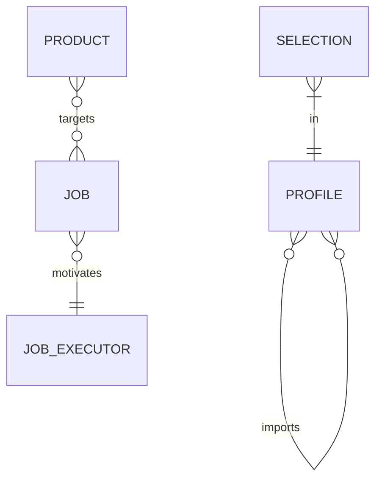

# Model

## Overview

<!-- overview: generated by `harness.py render`; do not edit -->

<!-- /overview -->

## Conventions

Every item has a document-unique id.

Retired: P-9.

Not checked by a query: P-2.

Generated checks: SCHEMA-LINK.

**Rules**

- **DOC-3** (error): every key of an item's ruleWaivers is the ID of a warning rule

**Derived**

- **DOC-2**: an item's stage is its own stage, or else the document's stage

## Product

Constraints are out of scope.

### PRODUCT

What a team builds and offers to job executors.

Anchor: added — unifies JTBD's product with C4 systems.

Attributes: none.

| Link | Target | Cardinality | Meaning |
|---|---|---|---|
| targets | JOB | zero or more | the jobs it is hired for |

**Rules**

- **P-1** (error): every ratified product targets at least one job [DOC-2]
- **P-2** (error): a deprecated product keeps its jobs

### JOB

The progress a job executor wants to make.

Anchor: exact — JTBD job.

| Attribute | Type | Required | Meaning |
|---|---|---|---|
| statement | string | yes | from the executor's perspective |
| kind | enum (core, related) | no | default core |
| tags | string[] | one or more | |

| Link | Target | Cardinality | Meaning |
|---|---|---|---|
| motivates | JOB_EXECUTOR | exactly one | who does the job |

**Guidance**

- a core job's statement is solution-free

### JOB_EXECUTOR

The person or group who does the job.

Anchor: exact — JTBD job executor.

Attributes: none.

Links: none.

## Governance

### SELECTION

A profile's choice to include or exclude one control.

Anchor: added — OSCAL-style profile selection.

| Attribute | Type | Required | Meaning |
|---|---|---|---|
| choice | enum (include, exclude) | yes | |
| rationale | string | when exclude | why |

| Link | Target | Cardinality | Meaning |
|---|---|---|---|
| in | PROFILE | exactly one; each target has one or more | the profile it belongs to |

### PROFILE

A company-level selection of controls.

Anchor: added — OSCAL profile.

| Attribute | Type | Required | Meaning |
|---|---|---|---|
| owner | string | yes | who decides changes |

| Link | Target | Cardinality | Meaning |
|---|---|---|---|
| imports | PROFILE | zero or more | profiles it narrows |

**Rules**

- **G-32** (warning): profile imports have no cycles

**Derived**

- **G-31**: a profile includes a control when it, or a profile it imports, includes it [P-1]
